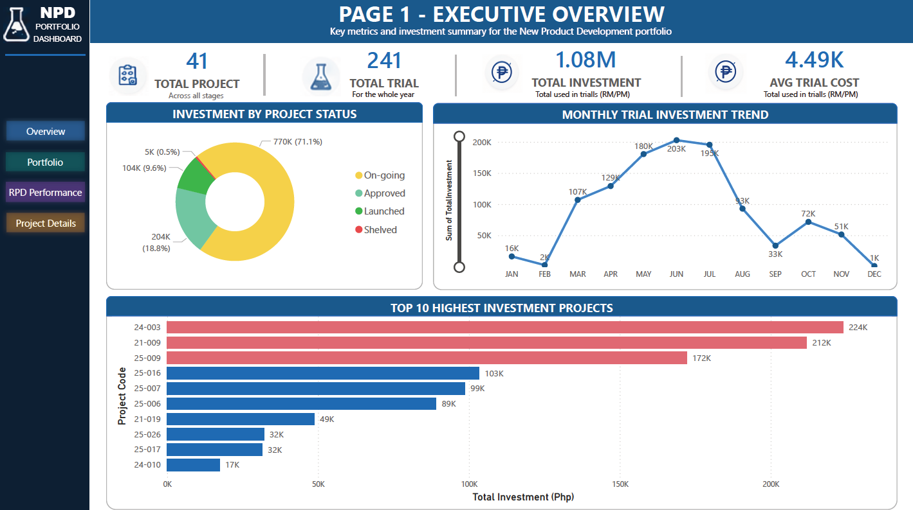
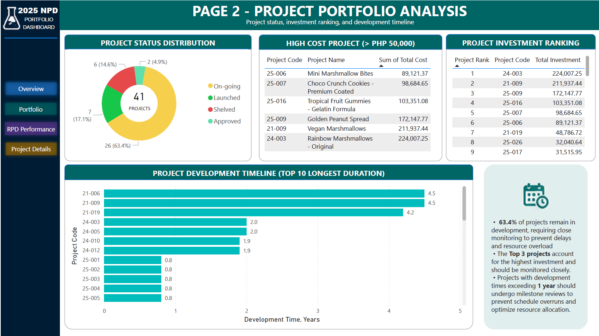
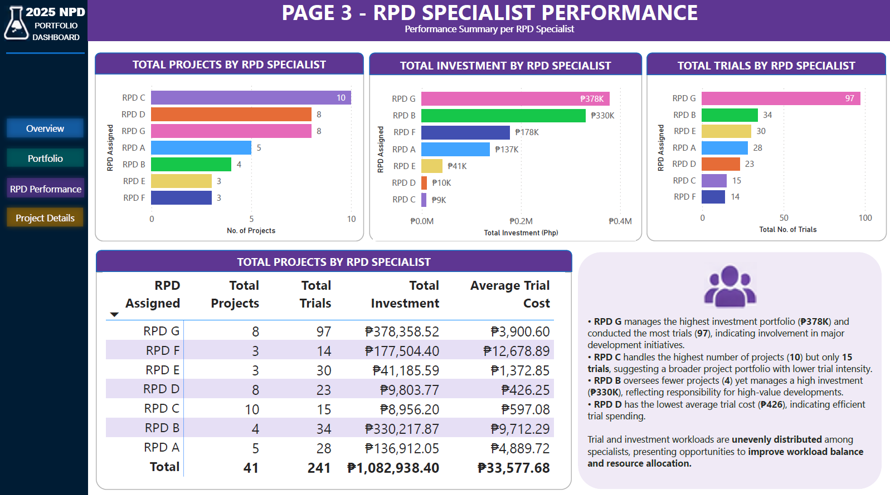
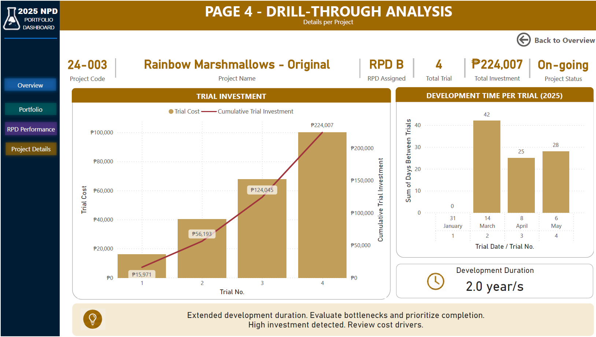

# NPD Portfolio Analytics

## Project Overview
This project is about analyzing New Product Development performance in a manufacturing R&D setting. In R&D, many projects run at the same time, and without a structured view, it becomes hard to monitor which projects are progressing, which are consuming high trial cost, and which resources are overloaded.

## Business Problem
In manufacturing R&D, multiple projects may run at the same time. This makes it important to monitor project progress, trial costs, resource allocation, and development efficiency.

## Tools Used
- SQL Server
- Power BI

## Key Metrics
- Total Projects
- Total Trials
- Total Investment
- Investment by Project Status
- Top 10 Highest Investment Projects
- Development Timeline
- RPD Specialist Performance

## SQL Skills Demonstrated
- INNER JOIN
- GROUP BY
- SUM, AVG, COUNT
- CASE WHEN
- RANK and ROW_NUMBER
- SQL Views
- Running Totals

## SQL Scripts

The `sql` folder contains SQL queries and views used for the analysis, including:

- Executive overview - What is the overall portfolio performance?
- Investment by project status
- Monthly trial investment trend
- Top 10 highest investment projects
- Project status distribution
- High-cost project classification
- Project investment ranking
- Project development timeline
- RPD specialist performance
- Project drill-through data

## Power BI Skills Demonstrated
- Data modeling
- DAX measures
- KPI cards
- Bar charts
- Donut charts
- Drill-through page
- Dashboard storytelling
  
## Dashboard Screenshots

### Executive Overview

### Project Portfolio

### RPD Performance

### Project Drillthrough

## Data Privacy
This project uses synthetic and anonymized sample data. It does not contain actual company records, proprietary product information, internal formulas, or confidential business data.

