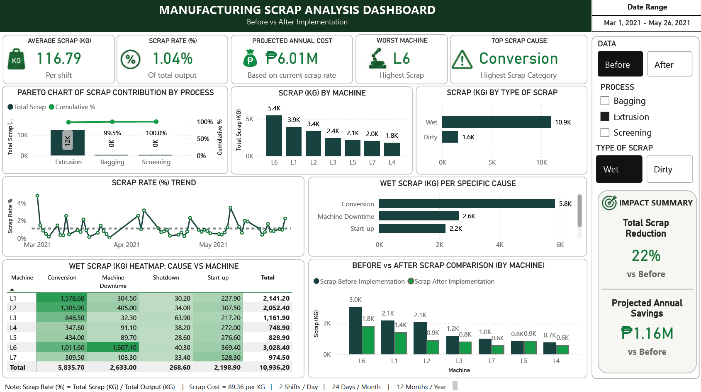

# Scrap Reduction Dashboard

## Project Overview
This project analyzes manufacturing scrap performance before and after process improvement implementation. The dashboard was designed to monitor scrap rate, scrap volume, machine-level contributors, scrap causes, and estimated financial impact.

The goal is to help identify the biggest scrap contributors, prioritize improvement actions, and quantify potential cost savings.

## Business Problem
Scrap generation increases production cost and reduces manufacturing efficiency. Without a clear dashboard, it can be difficult to identify which process, machine, or scrap cause contributes the most to losses.

This dashboard provides visibility into scrap trends, machine performance, and before-versus-after improvement results.

## Goal

The goal of this project is to develop an interactive Scrap Reduction Dashboard that helps monitor manufacturing scrap performance before and after process improvement implementation.

## Tools Used
- Power BI
- Excel
- Lean Six Sigma

## Key Metrics
- Average Scrap: 116.79 kg per shift
- Scrap Rate: 1.04% of total output
- Projected Annual Cost: ₱6.01M
- Worst Machine: L6
- Top Scrap Cause: Conversion
- Total Scrap Reduction: 22%
- Projected Annual Savings: ₱1.16M

## Dashboard Features
- KPI cards for scrap rate, average scrap, projected cost, worst machine, and top scrap cause
- Pareto chart of scrap contribution by process
- Scrap analysis by machine
- Scrap breakdown by type: Wet and Dirty
- Scrap rate trend over time
- Heatmap showing scrap cause versus machine
- Before vs After scrap comparison by machine
- Impact summary showing scrap reduction and projected savings

## Skills Demonstrated
- KPI analysis
- Manufacturing process analysis
- Cost savings calculation
- Before-and-after performance comparison
- Pareto analysis
- Root cause analysis
- Dashboard design
- Data storytelling
- Lean Six Sigma mindset

## Dashboard Screenshot

## Business Impact
The original improvement project resulted in approximately 22% total scrap reduction and around ₱1.16 million in projected annual savings.

The dashboard helps translate manufacturing data into actionable insights by showing which machines, processes, and scrap causes should be prioritized for improvement.

## Data Privacy
This portfolio project uses anonymized or synthetic sample data. It does not include actual company production records, machine identifiers, product names, internal formulas, confidential cost structures, supplier information, customer information, or proprietary business data.
